# Enterprise Two-Stage Recommendation Engine (`two-stage-recsys-dcn`)

[](https://github.com/Sawy05/two-stage-recsys-dcn/actions)
[](https://www.python.org/)
[](https://pytorch.org/)
[](https://fastapi.tiangolo.com/)

An enterprise-grade **Two-Stage Deep Learning Recommendation System** combining **Two-Tower Neural Vector Retrieval** (Stage 1), a **Deep & Cross Network v2 (`DCNv2`) Multi-Task Ranking Engine** (Stage 2), and a **Disjoint `LinUCB` Contextual Bandit** for cold-start item exploration.

---

## 1. Two-Stage Recommendation Funnel Architecture

```mermaid
flowchart LR
    Req["Client Request (user_id, session_context)"] --> Cache{"Redis User Vector Cache"}
    Cache -- "Cache Hit (<0.1ms)" --> UserVec["64D L2-Normalized User Embedding"]
    Cache -- "Cache Miss" --> UserTower["PyTorch User Tower Encoder"]
    UserTower --> UserVec

    subgraph Stage1["Stage 1: Candidate Generation & ANN Retrieval"]
        ItemCatalog["Full Item Catalog (5,000+ Items)"] --> ItemTower["PyTorch Item Tower (Offline Precompute)"]
        ItemTower --> HNSW["Qdrant / Milvus HNSW Index (M=16, ef=64)"]
        UserVec --> HNSW
        HNSW -- "Sub-5ms Cosine ANN" --> Top100["Top-100 Candidate Items"]
    end

    subgraph Stage2["Stage 2: Deep & Cross Network (DCNv2) Ranking"]
        Top100 --> FeatEng["Real-Time Session + Cross Feature Assembly"]
        FeatEng --> DCNv2["DCNv2 (Low-Rank Cross Layers + Deep MLP)"]
        DCNv2 --> MultiTask["Multi-Task Heads: pCTR & pCVR + Diversity Calibration"]
    end

    subgraph Stage3["Stage 3: Cold-Start Exploration (5% Traffic Slice)"]
        ColdPool["Zero-History Cold-Start Items"] --> LinUCB["LinUCB Contextual Bandit (UCB = θᵀx + α√(xᵀA⁻¹x))"]
        MultiTask --> Interleave["Bandit Traffic Interleaver (95% Exploit / 5% Explore)"]
        LinUCB --> Interleave
    end

    Interleave --> Feed["Final Ranked Top-20 Personalized Feed (<10ms P99)"]
```



---

## 2. Core Technical Capabilities

### Stage 1: Two-Tower Candidate Retrieval (`src/retrieval/`)
- **Independent Dual Encoders**: `UserTower` and `ItemTower` map sparse categorical IDs (`user_id`, `age_bucket`, `gender`, `region`, `device_tier`, `item_id`, `category_id`, `brand_id`, `price_tier`) and normalized dense behavioral/catalog features into a shared **64-dimensional L2-normalized embedding space**.
- **In-Batch Negative Sampling & Sampled Softmax Loss**: Contrastive temperature-scaled cross-entropy objective ($\tau = 0.07$) with accidental false-negative collision masking and optional $\log Q(y)$ sampling probability correction.
- **HNSW Vector Indexing**: Precomputes item embeddings and indexes them using Hierarchical Navigable Small World (**HNSW**, `M=16`, `efConstruction=128`, `efSearch=64`) backed by **Qdrant / Milvus** with an automatic in-memory HNSW fallback for zero-dependency execution.

### Stage 2: Deep & Cross Network (`DCNv2`) Ranking (`src/ranking/`)
- **Low-Rank Explicit Feature Crossing**: Implements factorized polynomial cross layers:
  $$x_{l+1} = x_0 \odot \bigl(U_l (V_l^T x_l) + b_l\bigr) + x_l, \quad U_l, V_l \in \mathbb{R}^{d \times r}$$
  reducing parameter complexity while capturing bounded-degree cross-features alongside a parallel Deep MLP (`[256, 128, 64]`).
- **Multi-Task Prediction Heads**: Jointly predicts **Click-Through Rate (`pCTR`)** and **Conversion Rate (`pCVR`)** trained with multi-task binary cross-entropy loss, combined with category-saturation diversity calibration.
- **Production Model Export**: Full support for **TorchScript** (`torch.jit.trace` / `torch.jit.freeze`) and **ONNX** (`opset 17`) with automated numerical parity verification (`max_diff < 1e-5`).

### Stage 3: Cold-Start Exploration via `LinUCB` (`src/bandits/`)
- **Upper Confidence Bound (`LinUCB`)**: Allocates a dedicated **5% exploration traffic slice** to newly added catalog items with zero interaction history (`impressions == 0`):
  $$\text{UCB}_a(x_t) = \hat{\theta}_a^T x_t + \alpha \sqrt{x_t^T A_a^{-1} x_t}$$
- **Online Sherman-Morrison Updates**: Updates inverse covariance matrices $A_a^{-1} \in \mathbb{R}^{d \times d}$ in $O(d^2)$ time upon receiving real-time click/conversion feedback via `POST /v1/bandit/feedback`.

---

## 3. Offline Evaluation Metrics

Evaluated on the built-in multi-modal synthetic e-commerce benchmark (`scripts/benchmark_latency.py`):

| Stage / Model | Metric | Value | Target Threshold |
| :--- | :--- | :---: | :---: |
| **Stage 1: Two-Tower Retrieval** | **Recall@50** | `0.6315` | `>= 0.5000` |
| **Stage 1: Two-Tower Retrieval** | **Recall@100** | `0.7532` | `>= 0.7000` |
| **Stage 2: DCNv2 Ranking** | **NDCG@10** | `0.9542` | `>= 0.7500` |
| **Stage 2: DCNv2 Ranking (CTR Head)** | **ROC-AUC (`pCTR`)** | `0.9682` | `>= 0.7500` |
| **Stage 2: DCNv2 Ranking (CVR Head)** | **ROC-AUC (`pCVR`)** | `0.9563` | `>= 0.7500` |
| **End-to-End Feed Quality** | **Category Diversity Ratio** | `0.2660` | `>= 0.2500` |

---

## 4. System Latency Breakdown

Measured across end-to-end requests (`top_k_retrieval=100`, `top_k_final=20`, CPU execution via `scripts/benchmark_latency.py`):

| Pipeline Stage | P50 Latency (ms) | P95 Latency (ms) | P99 Latency (ms) | SLA Budget (ms) |
| :--- | :---: | :---: | :---: | :---: |
| **User Vector Resolution (Redis / UserTower)** | `1.055 ms` | `1.439 ms` | `1.771 ms` | `< 5.00 ms` |
| **Stage 1: HNSW ANN Search (Top-100)** | `0.472 ms` | `0.548 ms` | `0.669 ms` | `< 5.00 ms` |
| **Stage 2: DCNv2 Batch Scoring (100 Candidates)** | `2.968 ms` | `3.652 ms` | `4.696 ms` | `< 25.00 ms` |
| **Stage 3: LinUCB Cold-Start Re-Ranking (5% Slice)** | `2.141 ms` | `2.710 ms` | `3.019 ms` | `< 5.00 ms` |
| **Total End-to-End Response Time** | **`6.758 ms`** | **`8.264 ms`** | **`9.060 ms`** | **`< 40.00 ms`** |

---

## 5. Project Directory Structure

```text
two-stage-recsys-dcn/
├── .github/
│   └── workflows/
│       └── ci.yml
├── .gitignore
├── .env.example
├── pyproject.toml
├── Dockerfile
├── docker-compose.yml
├── README.md
├── scripts/
│   ├── init_github.sh
│   └── benchmark_latency.py
├── configs/
│   └── model_config.yaml
├── src/
│   ├── __init__.py
│   ├── data/
│   │   ├── synthetic_interactions.py
│   │   └── dataloader.py
│   ├── retrieval/
│   │   ├── two_tower_model.py
│   │   ├── indexer.py
│   │   └── ann_search.py
│   ├── ranking/
│   │   ├── dcn_v2.py
│   │   ├── trainer.py
│   │   └── export.py
│   ├── bandits/
│   │   └── contextual_bandit.py
│   ├── service/
│   │   ├── main.py
│   │   ├── pipeline.py
│   │   └── schemas.py
└── tests/
    ├── test_two_tower_retrieval.py
    ├── test_ranking_forward.py
    └── test_pipeline_latency.py
```

---

## 6. Reproducibility & Quickstart Guide

### 6.1 Local Environment Setup
```bash
python -m pip install --upgrade pip
pip install -e ".[dev]"
```

### 6.2 Synthetic Data Generation, Training, Vector Indexing & Latency Benchmark
Run the self-contained end-to-end training, indexing, evaluation, and latency benchmark script (requires zero external downloads):
```bash
python scripts/benchmark_latency.py
```

### 6.3 Running the Test Suite & Linting
```bash
pytest -v
ruff check src tests scripts
black --check src tests scripts
```

### 6.4 Starting the High-Concurrency FastAPI Gateway
```bash
uvicorn src.service.main:app --host 0.0.0.0 --port 8000
```

Query the recommendation endpoint:
```bash
curl -X POST "http://localhost:8000/v1/recommend" \
  -H "Content-Type: application/json" \
  -d '{
    "user_id": 42,
    "top_k_retrieval": 100,
    "top_k_final": 20,
    "enable_exploration": true,
    "session_context": {
      "device_type": 2,
      "hour_of_day": 19,
      "day_of_week": 5,
      "exclude_item_ids": [10, 25]
    }
  }'
```

### 6.5 Docker Compose Deployment (FastAPI + Qdrant + Redis)
```bash
docker compose up --build -d
```

### 6.6 Automated GitHub Repository Publication
To initialize Git tracking on `main`, create `Sawy05/two-stage-recsys-dcn`, and push:
```bash
bash scripts/init_github.sh
```
